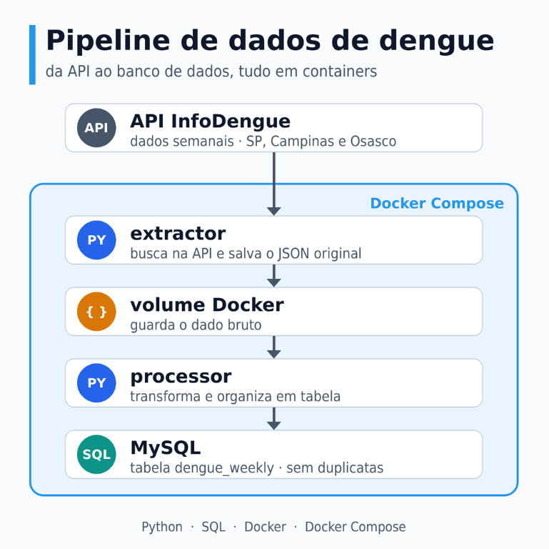
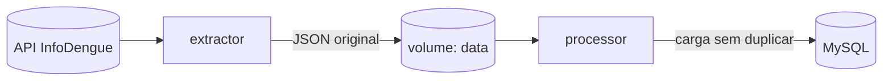
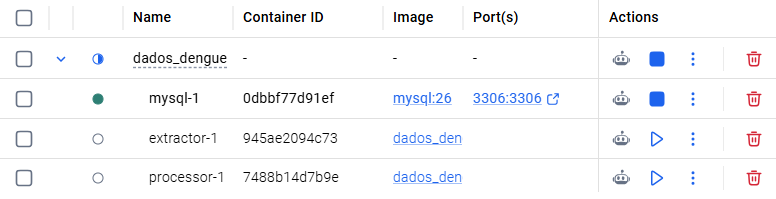
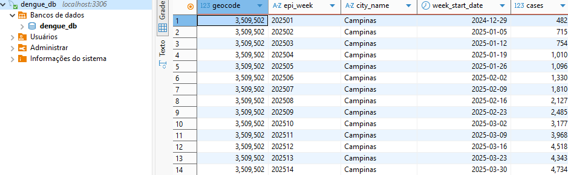

# Pipeline de Dados de Dengue (InfoDengue)

Pipeline de dados que coleta os dados semanais de dengue de três cidades paulistas (São Paulo, Campinas e Osasco), guarda o dado original e carrega uma tabela organizada e sem duplicatas em um banco MySQL. Tudo roda localmente, em containers Docker.

## Objetivo

Criar um processo repetível que busque o dado na fonte, guarde de forma segura e o organize em uma tabela que possa ser consultada com SQL, para responder perguntas como: como está a situação da dengue nessas cidades e em quais semanas houve mais casos?

## Fonte dos dados

API pública do [InfoDengue](https://info.dengue.mat.br/), sistema de alerta de dengue, chikungunya e zika. Para cada cidade e semana epidemiológica, ela informa casos, incidência por 100 mil habitantes, nível de alerta, população e dados de clima.
 
- **Cidades:** São Paulo, Campinas e Osasco
- **Período:** semanas 1 a 52 de 2025 (156 linhas no total)

## Como funciona

  

1. **Extractor:** consulta a API para cada cidade e salva a resposta, sem alterar nada, em um arquivo JSON. Guardar o dado original permite refazer a transformação depois sem chamar a API de novo.
2. **Processor:** lê os JSONs, escolhe os campos de interesse, converte os tipos (por exemplo, datas e números que vêm como texto) e transforma tudo em linhas de tabela.
3. **MySQL:** armazena a tabela `dengue_weekly`, com uma linha por cidade e por semana. Os dados ficam em um volume Docker e não se perdem quando o container é desligado.

## Sem dados duplicados
A tabela tem chave primária composta por **cidade + semana epidemiológica**, e a carga usa `INSERT ... ON DUPLICATE KEY UPDATE`. Assim, rodar o pipeline várias vezes não duplica linhas: o que já existe é atualizado. Esse comportamento é chamado de **idempotência**.

## Ferramentas e por que foram usadas

| Ferramenta | Onde entra | Por quê |
|---|---|---|
| **Python** | Extractor e processor | Tem bibliotecas prontas para consumir APIs (`requests`) e conversar com bancos (`mysql-connector-python`). |
| **MySQL / SQL** | Armazenamento e consulta | Organiza o dado em tabelas, garante regras como a chave primária e permite consultas. |
| **Docker e Dockerfile** | Imagem de cada aplicação | Empacota código e dependências para rodar igual em qualquer máquina. |
| **Docker Compose** | Orquestração | Sobe os serviços com um comando, conecta os containers e controla a ordem de execução. |
| **Volumes Docker** | `data` e `mysql_data` | Guardam os JSONs e o banco fora dos containers. |
| **Arquivo `.env`** | Credenciais | Mantém usuário e senha do banco fora do código e do GitHub. |
 
O Compose garante a ordem: o processor só começa quando o MySQL está saudável (`healthcheck`) e o extractor terminou com sucesso. O extractor e o processor rodam uma vez e terminam, e por isso aparecem como `Exited (0)` no Docker Desktop, o que é o esperado.

## Resultado 

Tabela `dengue_weekly` consultada no DBeaver:

