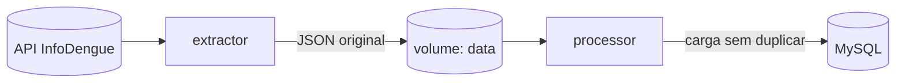

# Pipeline de Dados de Dengue (InfoDengue)

Pipeline de dados que coleta os dados semanais de dengue de três cidades paulistas (São Paulo, Campinas e Osasco), guarda o dado original e carrega uma tabela organizada e sem duplicatas em um banco MySQL. Tudo roda localmente, em containers Docker.

## Objetivo

Criar um processo repetível que busque o dado na fonte, guarde de forma segura e o organize em uma tabela que possa ser consultada com SQL, para responder perguntas como: como está a situação da dengue nessas cidades e em quais semanas houve mais casos?

## Fonte dos dados

API pública do [InfoDengue](https://info.dengue.mat.br/), sistema de alerta de dengue, chikungunya e zika. Para cada cidade e semana epidemiológica, ela informa casos, incidência por 100 mil habitantes, nível de alerta, população e dados de clima.
 
- **Cidades:** São Paulo, Campinas e Osasco
- **Período:** semanas 1 a 52 de 2025 (156 linhas no total)

## Como funciona

